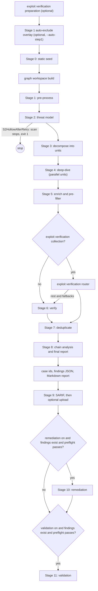

# VVAH workflow hierarchy

The workflow as organized in the source, from the command line down to stages and their components. Each node names the rendered file. Ordering and nesting come from `vvaharness/orchestrator/scan.py` (`scan_repo`, lines 380-1072) and the modules it calls. This index adds no ordering that the source lacks.

Harness: `visa-vulnerability-agentic-harness/`, package `vvaharness` 1.5.1.

## Level 1: entry points

- Command line `vvaharness` → `vvah/vvaharness/__main__.sudo`, `vvah/vvaharness/cli/__init__.sudo` (subcommands such as `scan`, `remediate`, `validate`, `setup`; see `cli/_commands.sudo`)
- Scan entry → `vvah/vvaharness/orchestrator/entry.sudo`: one repository, or many through `vvah/vvaharness/orchestrator/batch.sudo`
- Checks before a run → `vvah/vvaharness/orchestrator/preflight.sudo`
- Programmatic interface → `vvah/vvaharness/api.sudo`, `vvah/vvaharness/sdk/` (custom stages and plugins)
- Standalone remediation → `vvah/vvaharness/remediation_agent/remediate.sudo`
- Standalone validation → `vvah/vvaharness/validation/cli/__init__.sudo`

## Level 2: the pipeline for one repository

`vvah/vvaharness/orchestrator/scan.sudo`, function `scan_repo`. The stages run in this order. Each step after Stage 0 depends on the previous one, and a resumed run reuses a stage only if its upstream stage was reused.

`--stop-after` can end the run after `ev`, `s0` ... `s11`.

## Level 3: stages and their components

| Stage | Console title in source | Stage file | Components (prompts, model session, outcome handling) |
|---|---|---|---|
| (before Stage 1) | auto-step1 | `pipeline/stages/s1_autoexclude.sudo` | model-written exclusion overlay and veto rules |
| s0 | "Step 0 — Static seed (rules)" | `pipeline/stages/s0_seed.sudo` | `detect/`, `rules/`, `lang/` |
| s1 | "Step 1 — Pre-process" | `pipeline/stages/s1_preprocess.sudo` | `scope/`, `evidence/`, `injectors/`, `codegraph/` |
| s2 | "Step 2 — Threat model" | `pipeline/stages/s2/__init__.sudo` | `s2/prompts.sudo`, `s2/session.sudo`, `s2/outcomes.sudo`, `s2/baseline.sudo`, `s2_planning.sudo` |
| s3 | "Step 3 — Decompose" | `pipeline/stages/s3_decompose.sudo` | `models/scan/work.sudo` |
| s4 | "Step 4 — Deep-dive" | `pipeline/stages/s4_deepdive.sudo` | `s4/batching.sudo`, `s4/prompts.sudo`, `s4/session.sudo`, `s4/outcomes.sudo`, `skills/` |
| s5 | "Step 5 — Enrich (snippet + evidence refs, deterministic)" | `pipeline/stages/s5/__init__.sudo` | `s5/enrich.sudo`, `s5/gates.sudo`, `s5/detectors.sudo`, `s5/reanchor.sudo`, `s5/rules.sudo` |
| s6 | "Step 6 — Verify" | `pipeline/stages/s6_verify.sudo` | `s6/batching.sudo`, `s6/prompts.sudo`, `s6/session.sudo`, `s6/outcomes.sudo` |
| s6 (with exploit verification) | "Step 6 — Verify" (same stage, other branch) | `exploit_verification/verify/router.sudo` | taken when `ctx.ev_collection` is set (scan.py:766-772); the router verifies live-verifiable findings against the target and still sends the rest, and every finding on its fallback paths, to `s6_verify` (router.py `_static`). Components: `verify/` (run, judge, oracle, repro, prompt), `classify/`, `executor/`, `mapping/`, `payloads/`, `collection/`, `replay/`, `gate.sudo`, `safety.sudo`, `probe.sudo`; preparation in `orchestrator/scan.sudo` `_ev_prep` |
| s7 | "Step 7 — Dedup" | `pipeline/stages/s7_dedup.sudo` | `s7/collapse.sudo`, `s7/prompts.sudo`, `s7/session.sudo`, `s7/outcomes.sudo` |
| s8 | "Step 8 — Chain" | `pipeline/stages/s8_chain.sudo` | `s8/facts.sudo`, `s8/window.sudo`, `s8/prompts.sudo`, `s8/session.sudo`, `s8/validate.sudo`, `s8/outcomes.sudo` |
| s9 | "Step 9 — SARIF" | `pipeline/stages/s9_sarif.sudo` | `s9/typed_sarif.sudo`, `s9/health.sudo`, `report/` |
| s10 | "Step 10 — Remediate" | `orchestrator/scan.sudo` (`_run_remediation`) | `remediation_agent/runner.sudo` and the rest of `remediation_agent/` |
| s11 | "Step 11 — Validate (s11)" | `pipeline/stages/s11_validate.sudo` | `validation/` |
| (resume) | — | `pipeline/stages/replay.sudo`, `orchestrator/checkpoints.sudo`, `orchestrator/store/` | checkpoint rules |

All stage paths are under `vvah/vvaharness/`. A row whose file does not exist means that source file was skipped or not covered. `coverage.tsv` is the authority.

## Level 4: shared layers called by the stages

- Model routes and agent sessions: `backends/llm/` (routes `cli`, `sdk`, `openai`, `deepagents`; `registry.sudo` selects) and `backends/harness/` (session options, tool permissions, budgets, guards).
- Data types passed between stages: `models/` (`ContextPackage`, `ThreatModel`, `TaskManifest`, `InvestigationUnit`, `Finding`, `FinalReport`, verdicts).
- Configuration: `config/__init__.sudo` (built-in defaults and merging) and `config/profiles/*.sudo.md` (the five shipped profiles).
- Exploit verification against a live target: `exploit_verification/` (safety gates, auth, out-of-band callbacks, rate and concurrency limits; see the "s6 (with exploit verification)" row above).
- Extension points: `sdk/` (custom stages and plugins), `plugins/semgrep/`.
- Utilities that affect decisions: `util/` (response quality, JSON extraction, tokens and pricing, environment checks).
